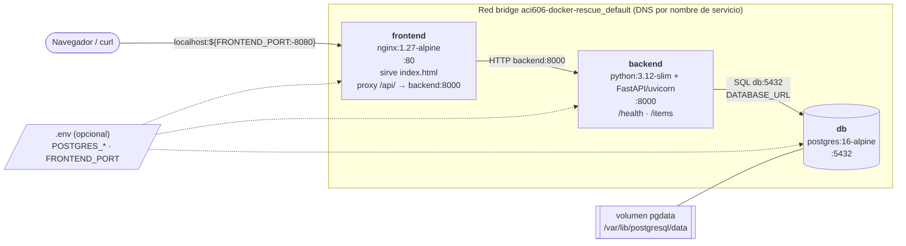

# ACI606 - Docker Rescue Challenge

Aplicación web multi-servicio **recuperada**: se recibió con fallas deliberadas de construcción, configuración, comunicación y operación. Este repositorio contiene el proyecto reparado, la evidencia de cada diagnóstico y el informe técnico.

- **Asignatura:** ACI606 Especialidad II: Cloud Computing, Evaluación 2
- **Informe técnico:** [`informe/`](informe/) (LaTeX; el PDF se entrega aparte)
- **Evidencia:** [`evidencia/`](evidencia/) (salidas reales de los comandos, archivos `R-*` reparaciones, `M-*` mejoras y `P-*` pruebas)

## Arquitectura



| Servicio | Imagen | Puerto | Healthcheck | Arranca cuando… |
|---|---|---|---|---|
| `frontend` | build `./frontend` (Nginx) | host `${FRONTEND_PORT:-8080}` → contenedor `80` | `wget --spider http://127.0.0.1/` | `backend` está *healthy* |
| `backend` | build `./backend` (FastAPI) | `8000` (solo en la red interna) | `python -c urllib…/health` (verifica también la BD) | `db` está *healthy* |
| `db` | `postgres:16-alpine` | `5432` (solo en la red interna) | `pg_isready` | — |

Solo el frontend se publica en el host. El backend y la base de datos son accesibles únicamente dentro de la red de Compose, por nombre de servicio (`backend`, `db`), nunca por `localhost`.

## Requisitos

- Docker Engine con el plugin **Docker Compose v2** (`docker compose version`). Funciona en GitHub Codespaces.
- `curl` para las verificaciones.

## Configuración (opcional)

`compose.yaml` trae valores por defecto (`${VAR:-valor}`), así que **un clon limpio arranca sin crear nada**. Para personalizarlos:

```bash
cp .env.example .env     # y editar los valores
```

| Variable | Por defecto | Uso |
|---|---|---|
| `POSTGRES_USER` | `appuser` | usuario de PostgreSQL y del `DATABASE_URL` del backend |
| `POSTGRES_PASSWORD` | `rescue123` | contraseña (una sola fuente para `db` y `backend`) |
| `POSTGRES_DB` | `appdb` | base de datos |
| `FRONTEND_PORT` | `8080` | puerto del host para el frontend |

> ⚠️ `POSTGRES_*` solo se aplican cuando el volumen `pgdata` está **vacío**. Si cambia la contraseña después del primer arranque, recree el volumen (ver [Reiniciar desde cero](#reiniciar-desde-cero-borra-los-datos)).

`.env` no se versiona (está en `.gitignore`).

## 1. Construir e iniciar

```bash
docker compose up --build -d --wait
```

`--wait` espera a que los tres healthchecks pasen a *healthy* y termina con error si alguno falla. El orden de arranque es `db` → `backend` → `frontend` (`depends_on` con `condition: service_healthy`).

## 2. Verificar

```bash
docker compose ps                                   # los 3 servicios: Up (healthy)
curl -i localhost:8080/                             # 200, index.html servido por Nginx
curl -i localhost:8080/api/health                   # 200 {"status":"ok","database":"reachable"}
curl -i -X POST localhost:8080/api/items \
     -H 'Content-Type: application/json' -d '{"name":"prueba"}'   # 201
curl -s localhost:8080/api/items                    # lista con el ítem creado
```

También se puede abrir `http://localhost:8080` en el navegador (en Codespaces, desde la pestaña *Ports*).

Diagnóstico:

```bash
docker compose logs -f <servicio>                   # frontend | backend | db
docker compose config                               # configuración final interpolada
docker inspect --format '{{json .State.Health}}' aci606-docker-rescue-backend-1
docker compose exec db sh -c 'psql -U "$POSTGRES_USER" -d "$POSTGRES_DB" -c "SELECT * FROM items;"'
```

Validación completa en un entorno limpio (prueba P-07: genera `evidencia/P-07-*.txt`):

```bash
bash scripts/p07-validacion-limpia.sh
```

## 3. Detener

```bash
docker compose stop        # detiene los contenedores, los conserva
docker compose down        # elimina contenedores y red; el volumen pgdata (datos) se conserva
```

## 4. Recrear

```bash
docker compose up -d --force-recreate          # recrea todos los contenedores con los mismos datos
docker compose up -d --build --force-recreate  # además reconstruye las imágenes
```

Como los datos están en el volumen nombrado `pgdata`, sobreviven a `down`/`up` y a la recreación de `db`.

### Reiniciar desde cero (borra los datos)

```bash
docker compose down -v     # ⚠️ elimina también el volumen pgdata
docker compose up --build -d --wait
```

## Política de reinicio

`backend` y `frontend` usan `restart: unless-stopped`: si el proceso termina con error, Docker lo reinicia automáticamente, pero un `docker compose stop` manual se respeta. `db` no tiene política de reinicio, por lo que en la prueba de fallo controlado (P-04: `docker compose stop db`) la base de datos queda detenida hasta su recuperación manual (P-06: `docker compose start db`), mientras el backend sigue vivo y reporta `503` en `/api/health`.

## Reparaciones y mejoras

| ID | Archivo | Falla encontrada | Corrección |
|---|---|---|---|
| R-01 | `compose.yaml` | Puerto publicado `8080:8080`, pero Nginx escucha en el 80 | `8080:80` |
| R-02 | `backend/Dockerfile` | `uvicorn app:app`, pero el módulo es `main.py` | `uvicorn main:app` |
| R-03 | `backend/requirements.txt` | Faltaba el driver de PostgreSQL | `psycopg2-binary==2.9.10` |
| R-04 | `compose.yaml` | `DATABASE_URL` apuntaba a `localhost` (el propio backend) | host `db` |
| R-05 | `compose.yaml` | Contraseña `wrongpass` ≠ `rescue123` de la BD | credenciales consistentes |
| R-06 | `frontend/nginx.conf` | `proxy_pass http://localhost:8000/` (el propio Nginx) | `http://backend:8000/` |
| R-07 | `compose.yaml` | `depends_on` no esperaba a PostgreSQL (carrera en el arranque) | healthcheck en `db` + `condition: service_healthy` |
| M-01 | `compose.yaml` | Sin persistencia | volumen nombrado `pgdata` |
| M-02 | `compose.yaml`, `.env.example` | Configuración rígida y duplicada | variables con valores por defecto, `DATABASE_URL` compuesta |
| M-03 | `compose.yaml` | Sin healthchecks en backend y frontend | healthchecks funcionales + `restart` |

El detalle de cada incidencia (síntoma, evidencia, causa raíz, corrección, verificación e impacto) está en el informe técnico.

## Estructura

```text
.
├── compose.yaml              # orquestación de los 3 servicios
├── .env.example              # plantilla de configuración (copiar a .env, opcional)
├── backend/                  # FastAPI: Dockerfile, requirements.txt, main.py
├── frontend/                 # Nginx: Dockerfile, nginx.conf, index.html
├── scripts/
│   └── p07-validacion-limpia.sh
├── evidencia/                # salidas de comandos por incidencia y prueba
└── informe/                  # informe técnico en LaTeX
```
